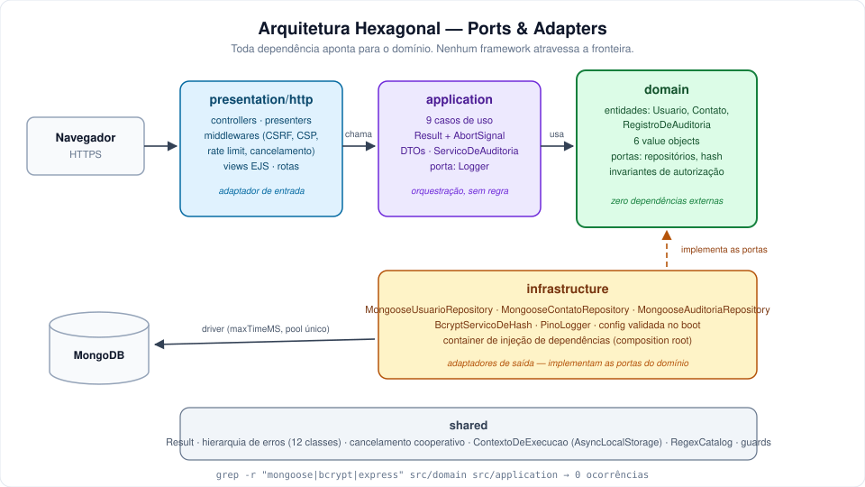

# Agenda de Contatos

Aplicação web full-stack com autenticação, construída em **arquitetura Hexagonal
(Ports & Adapters)** sobre Node.js. Cada usuário gerencia a própria agenda de
contatos e compromissos, com trilha de auditoria consultável, cancelamento
cooperativo de requisições e uma suíte de 172 testes automatizados.

**Demonstração ao vivo:** <https://agenda.eduardovalente.dev>

<p>
  <a href="https://agenda.eduardovalente.dev"></a>
  <a href="https://eduardovalente.dev/"></a>
  
  
  
  
  
  
</p>

---

## Objetivo

Este projeto nasceu de um CRUD de tutorial e foi reconstruído até o nível que um
sistema em produção exige. O objetivo não é o domínio em si — uma agenda de
contatos é deliberadamente simples — mas demonstrar **como** um sistema é
construído quando as decisões são levadas a sério:

- fronteiras arquiteturais que podem ser **verificadas**, não apenas prometidas;
- segurança tratada como requisito de projeto, com testes de regressão de
  vulnerabilidade;
- observabilidade, resiliência e infraestrutura como código;
- cada decisão relevante registrada como ADR, com o trade-off explícito.

A auditoria inicial encontrou uma falha grave: a coleção de contatos não possuía
campo de proprietário — qualquer usuário lia, editava e apagava contatos de
todos, e a página inicial listava a base inteira para visitantes anônimos. A
correção não foi um `if` a mais: a propriedade virou **invariante do agregado**,
impossível de burlar por qualquer caminho de código.

---

## Principais funcionalidades

| Funcionalidade                | Descrição                                                                                                                                                    |
| ----------------------------- | ------------------------------------------------------------------------------------------------------------------------------------------------------------ |
| **Autenticação**              | Cadastro, login e logout com bcrypt, regeneração de sessão no login (anti session fixation), política de força de senha e defesa contra enumeração de contas |
| **Agenda de contatos**        | CRUD escopado por dono; nenhum usuário alcança dados de outro, garantido no domínio e reforçado no filtro da consulta                                        |
| **Etiquetas e favoritos**     | Organização por etiquetas normalizadas no domínio, com seletor de chips e sugestões; favoritos alternados por POST autenticado e auditado                    |
| **Busca e filtros**           | Busca por nome, e-mail ou telefone com escape de metacaracteres (proteção contra ReDoS); filtros por etiqueta e favoritos preservados na paginação           |
| **Compromissos e calendário** | Agregado próprio, grade mensal renderizada no servidor no fuso America/Sao_Paulo, vínculo opcional a um contato com verificação de posse                     |
| **Painel de visão geral**     | Totais, distribuição por etiqueta, adicionados recentemente e próximos compromissos — gráficos em SVG e CSS, sem biblioteca externa                          |
| **Exportação de dados**       | CSV com BOM UTF-8, separador `;` e neutralização de fórmulas (CSV injection), além de JSON; toda exportação entra na trilha de auditoria                     |
| **Trilha de auditoria**       | Cada usuário consulta o histórico da própria conta — login, alterações, tentativas recusadas — com retenção automática por índice TTL                        |
| **Tema claro e escuro**       | Alternância manual persistida, com respeito à preferência do sistema operacional quando não há escolha explícita                                             |

---

## Tecnologias utilizadas

| Camada              | Tecnologias                                                                                           |
| ------------------- | ----------------------------------------------------------------------------------------------------- |
| **Runtime**         | Node.js 20+                                                                                           |
| **HTTP**            | Express 4                                                                                             |
| **Interface**       | EJS com renderização no servidor, CSS próprio com design tokens, JavaScript progressivo sem framework |
| **Persistência**    | MongoDB 7 com Mongoose 7                                                                              |
| **Sessão**          | express-session com connect-mongo                                                                     |
| **Segurança**       | helmet, express-rate-limit, bcryptjs, validator, CSRF próprio                                         |
| **Observabilidade** | pino e pino-http com logs estruturados                                                                |
| **Testes**          | node:test, supertest, mongodb-memory-server                                                           |
| **Qualidade**       | ESLint, Prettier                                                                                      |
| **Infraestrutura**  | Docker multi-stage, Docker Compose, Terraform, GitHub Actions, Fly.io                                 |

A interface não usa framework de frontend por decisão consciente: o produto é
renderizado no servidor, e adicionar React traria um passo de build, um bundle e
uma camada de estado sem resolver nenhum problema existente. O JavaScript do
cliente é progressivo — sem ele, todos os formulários continuam funcionando.

---

## Arquitetura da solução



Quatro camadas concêntricas, com toda dependência apontando para o domínio. A
inversão acontece nas **portas**: o domínio declara interfaces
(`ContatoRepository`, `ServicoDeHash`), e a infraestrutura as implementa.

A regra de dependência é **testável, não uma promessa**:

```bash
grep -r "mongoose\|bcrypt\|express" src/domain src/application
# saída esperada: nenhuma ocorrência
```

### Decisões de projeto

Registradas como ADRs em [`docs/adr/`](docs/adr/), com contexto, alternativas
consideradas e consequências negativas assumidas:

| ADR  | Decisão                                                           |
| ---- | ----------------------------------------------------------------- |
| 0001 | Manter monólito modular em vez de microsserviços                  |
| 0002 | Autorização também no filtro da consulta (defesa em profundidade) |
| 0003 | CSRF próprio no lugar do `csurf` descontinuado                    |
| 0004 | ECS Fargate em vez de Kubernetes                                  |
| 0005 | Sessão no servidor em vez de JWT                                  |
| 0006 | Hexagonal em vez de Clean Architecture                            |
| 0007 | `Result` pattern em vez de exceções para regra de negócio         |
| 0008 | Cancelamento cooperativo com `AbortSignal`                        |
| 0009 | Injeção de dependências manual, sem framework                     |
| 0010 | Trilha de auditoria com contexto via `AsyncLocalStorage`          |

Detalhamento completo em [`docs/ARQUITETURA.md`](docs/ARQUITETURA.md).

---

## Pré-requisitos

**Com Docker (recomendado)**

- Docker 24+ e Docker Compose v2

**Sem Docker**

- Node.js 20.11 ou superior
- MongoDB 7 acessível (local ou Atlas)
- OpenSSL para gerar segredos (ou equivalente)

---

## Instalação

```bash
git clone https://github.com/eduardocvalente/agenda-hexagonal.git
cd agenda-hexagonal
npm install
```

---

## Configuração

Todas as variáveis são documentadas em [`.env.example`](.env.example). Copie o
arquivo e preencha os segredos:

```bash
cp .env.example .env
```

Gere um segredo de sessão forte:

```bash
openssl rand -hex 32
```

### Variáveis obrigatórias

| Variável         | Descrição                                                        |
| ---------------- | ---------------------------------------------------------------- |
| `MONGODB_URI`    | String de conexão do MongoDB                                     |
| `SESSION_SECRET` | Mínimo de 32 caracteres; trocar invalida todas as sessões ativas |

### Variáveis relevantes

| Variável                  | Padrão  | Descrição                                                           |
| ------------------------- | ------- | ------------------------------------------------------------------- |
| `PORT`                    | `3000`  | Porta HTTP                                                          |
| `BCRYPT_ROUNDS`           | `12`    | Custo do bcrypt; `4` apenas em testes                               |
| `COOKIE_SECURE`           | `false` | Obrigatoriamente `true` em produção (exige HTTPS)                   |
| `TRUST_PROXY_HOPS`        | `0`     | Número de proxies confiáveis à frente da aplicação                  |
| `AUTH_RATE_LIMIT_MAX`     | `10`    | Tentativas de autenticação por janela                               |
| `AUDITORIA_RETENCAO_DIAS` | `180`   | Retenção da trilha; registros vencidos são removidos por índice TTL |

A aplicação **recusa iniciar** se qualquer variável obrigatória estiver ausente
ou fraca, e a mensagem de erro lista exatamente o que corrigir. Falhar no boot é
preferível a subir mal configurada e falhar em produção.

---

## Como executar localmente

```bash
npm run dev
```

Aplicação disponível em <http://localhost:3000>.

Para popular a base com uma conta inicial e dados de demonstração:

```bash
ADMIN_EMAIL=admin@example.com ADMIN_PASSWORD='sua-senha-de-12-caracteres' SEED_DEMO=1 npm run seed
```

O seed é **idempotente**: rodar duas vezes não duplica nada.

---

## Como executar com Docker

```bash
cp .env.example .env
printf 'SESSION_SECRET=%s\nMONGO_APP_PASSWORD=%s\n' "$(openssl rand -hex 32)" "$(openssl rand -hex 16)" >> .env
docker compose up --build
```

Sobe a aplicação e um MongoDB já configurado. A imagem é multi-stage e executa
como usuário **não-root**, com health check embutido.

Para rodar a suíte completa em contêiner:

```bash
docker compose -f docker-compose.test.yml up --abort-on-container-exit
```

---

## Estrutura de pastas

```
cadastro_usuario/
├── .github/                    workflows de CI/CD, templates de issue e PR
├── docs/
│   ├── ARQUITETURA.md          detalhamento das camadas e fronteiras
│   ├── adr/                    decisões arquiteturais registradas
│   └── diagrams/               diagrama da arquitetura (SVG e fonte Draw.io)
├── infra/terraform/            infraestrutura como código (AWS ECS Fargate)
├── public/assets/              CSS, JavaScript e imagens servidos estaticamente
├── scripts/                    seed, migrations versionadas, backup e restore
├── src/
│   ├── domain/                 entidades, value objects e portas. Sem I/O.
│   │   ├── entities/           Usuario, Contato, Compromisso, RegistroDeAuditoria
│   │   ├── value-objects/      Email, Telefone, Etiquetas, DataHora, entre outros
│   │   ├── repositories/       portas de persistência
│   │   └── ports/              porta de hashing
│   ├── application/            casos de uso, DTOs e Result. Sem framework.
│   ├── infrastructure/         adaptadores: Mongoose, bcrypt, pino, container de DI
│   ├── presentation/           adaptador HTTP: Express, EJS, middlewares
│   └── shared/                 Result, hierarquia de erros, cancelamento, contexto
├── tests/
│   ├── unit/                   99 testes sem I/O
│   ├── integration/            73 testes com MongoDB em memória
│   └── load/                   roteiro de carga (k6)
├── Dockerfile                  imagem multi-stage, não-root
├── docker-compose.yml          ambiente local completo
└── fly.toml                    configuração do ambiente publicado
```

---

## Exemplos de uso

### Testes e qualidade

```bash
npm test                # 172 testes (~25 s)
npm run test:unit       # 99 unitários, sem banco
npm run test:coverage   # com relatório de cobertura
npm run lint            # ESLint
npm run format          # Prettier
```

Os testes de integração sobem um MongoDB em memória — nenhum banco externo é
necessário. Os testes de segurança são de **regressão de vulnerabilidade**: cada
um reproduz o ataque concreto que a arquitetura impede.

```javascript
// tests/integration/contato-authorization.test.js
test('outro usuário não consegue editar contato alheio', async () => {
  const { id } = await criarContatoDe('dono@example.com');
  const intruso = await signUpAndLogin(request, ctx.app, { email: 'intruso@example.com' });

  await intruso.agent
    .post(`/contato/edit/${id}`)
    .type('form')
    .send({ _csrf: intruso.csrf, nome: 'INVADIDO', telefone: '11111111111' })
    .expect(302);

  const doc = await ctx.models.ContatoModel.findById(id);
  assert.equal(doc.nome, 'Contato de dono@example.com');
});
```

### Verificando a fronteira arquitetural

```bash
grep -r "mongoose\|bcrypt\|express" src/domain src/application
```

Nenhuma ocorrência: o domínio e a aplicação não conhecem detalhe de
infraestrutura algum.

### Migrations e operação

```bash
npm run migrate -- --dry   # lista o que seria aplicado
npm run migrate            # aplica as pendentes, de forma idempotente
```

### Health checks

```bash
curl https://agenda.eduardovalente.dev/healthz   # responde sem tocar no banco
curl https://agenda.eduardovalente.dev/readyz    # confirma a dependência do MongoDB
```

---

## Roadmap

**Concluído**

- [x] Correção das falhas de autorização e propriedade dos dados
- [x] Refatoração para arquitetura Hexagonal com fronteiras verificáveis
- [x] Trilha de auditoria com contexto de execução
- [x] Etiquetas, favoritos, busca e filtros
- [x] Compromissos com calendário mensal
- [x] Exportação em CSV e JSON
- [x] Deploy contínuo com domínio próprio e HTTPS

**Em andamento**

- [ ] Colaboração: grupos, papéis (administrador, editor, leitor) e convites por
      link com token expirável

**Planejado**

- [ ] Agenda compartilhada por grupo, com permissões por recurso
- [ ] Recuperação de senha por e-mail (depende de provedor SMTP)
- [ ] Notificações e lembretes de compromissos
- [ ] Internacionalização

---

## Infraestrutura como código

O diretório [`infra/terraform/`](infra/terraform/) contém a definição modular de
uma infraestrutura AWS — ECS Fargate, ALB, VPC com sub-redes públicas e
privadas, Secrets Manager e backend remoto com bloqueio de estado — organizada
em ambientes de staging e produção.

**Esta infraestrutura não está provisionada.** Ela é validada em CI
(`terraform validate` e `plan`), mas nunca foi aplicada: o ambiente publicado
roda no Fly.io, cuja configuração está em [`fly.toml`](fly.toml). O pipeline
correspondente (`.github/workflows/cd.yml`) tem gatilho manual pelo mesmo
motivo.

Manter o código sem aplicá-lo é uma escolha registrada, não um descuido — e
declará-la é mais honesto do que sugerir uma infraestrutura que não existe.

---

## Licença

Este projeto está sob **licença proprietária**. Copyright (c) 2026 Eduardo
Valente. Todos os direitos reservados.

O código está publicamente visível para fins de **avaliação técnica e
demonstração de portfólio**. Não é software livre nem open source: cópia,
redistribuição, modificação, uso comercial ou incorporação em outros trabalhos
não são autorizados sem permissão expressa por escrito do autor.

Consulte o arquivo [`LICENSE`](LICENSE) para os termos completos.

---

## Contribuição

Este é um projeto pessoal de portfólio, mantido por um único autor para
demonstração técnica. Pela natureza da licença, **pull requests externos não são
aceitos**.

Contribuições de outro tipo são bem-vindas:

- **Encontrou um defeito?** Abra uma issue usando o template de bug report.
- **Tem uma dúvida sobre uma decisão de projeto?** Abra uma issue com o template
  de pergunta — as decisões estão documentadas nos ADRs, e ficaria feliz em
  discutir os trade-offs.
- **Identificou uma vulnerabilidade?** Não abra issue pública. Siga o processo
  descrito em [`SECURITY.md`](SECURITY.md).

Diretrizes completas em [`CONTRIBUTING.md`](CONTRIBUTING.md) e
[`CODE_OF_CONDUCT.md`](CODE_OF_CONDUCT.md).

---

## Contato

**Eduardo Valente** — Engenheiro de Software (Backend / Full Stack)

- Portfólio: <https://eduardovalente.dev/>
- Demonstração deste projeto: <https://agenda.eduardovalente.dev>
- GitHub: [@eduardocvalente](https://github.com/eduardocvalente)
