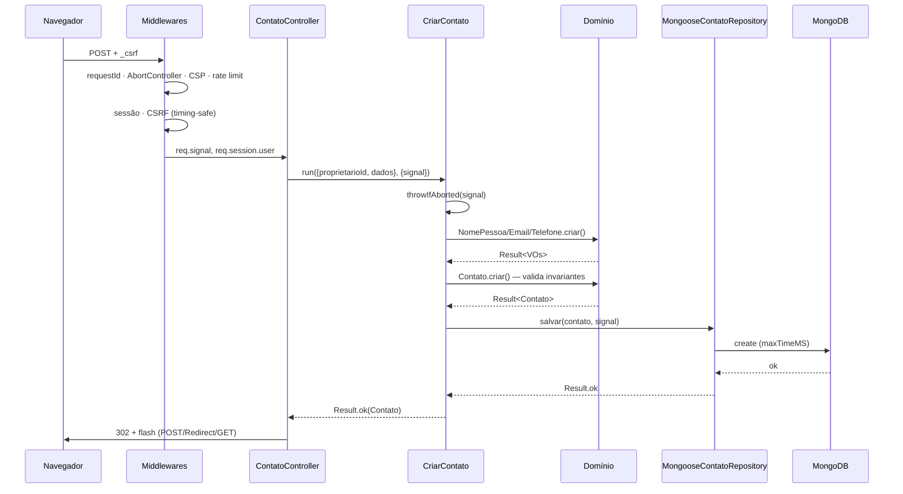
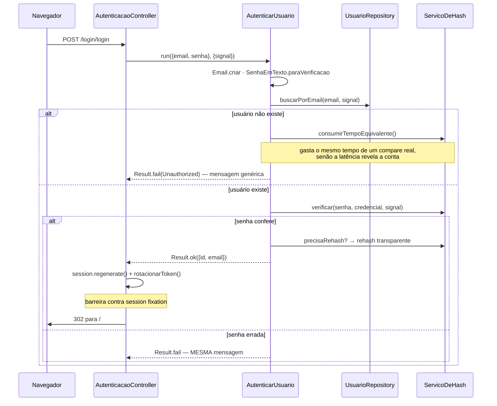

# Arquitetura

Arquitetura Hexagonal (Ports & Adapters) com Value Objects e entidades ricas.

---

## Por que Hexagonal, e não Clean ou Onion

As três resolvem o mesmo problema — impedir que detalhe de infraestrutura
contamine a regra de negócio — e diferem no vocabulário e no número de anéis.

| Arquitetura        | Vocabulário                                         | Anéis | Adequação aqui                                                       |
| ------------------ | --------------------------------------------------- | ----- | -------------------------------------------------------------------- |
| Clean Architecture | Entities, Use Cases, Interface Adapters, Frameworks | 4     | Sobra um anel: "Interface Adapters" e "Frameworks" colapsam em um só |
| Onion              | Domain Model, Domain Services, Application, Infra   | 4     | "Domain Services" quase vazio: há um único serviço puro              |
| **Hexagonal**      | **Domínio, Portas, Adaptadores**                    | **3** | **Escolhida**                                                        |

A escolha é pelo vocabulário mais direto para o formato real do problema: existe
um dentro (regras de contato, política de senha, regras de auditoria) e um
fora (HTTP, EJS, MongoDB, bcrypt, pino). "Porta" e "adaptador" nomeiam
exatamente isso, sem introduzir um anel que ficaria quase vazio.

Na prática as três produziriam quase o mesmo grafo de dependências. O ganho é de
comunicação: `ContatoRepository` é obviamente uma porta e
`MongooseContatoRepository` é obviamente o adaptador. Registrado no **ADR-0006**.

---

## A regra de dependência

```
                    ┌─────────────────────────────────┐
                    │        infrastructure/          │
   ┌────────────┐   │  Mongoose · bcrypt · pino       │
   │presentation│   │  container (composition root)   │
   │   HTTP     │   └──────────────┬──────────────────┘
   │ EJS/Express│                  │ implementa
   └─────┬──────┘                  ▼
         │ chama          ┌─────────────────┐
         └───────────────►│  application/   │
                          │  casos de uso   │
                          │  DTOs · portas  │
                          └────────┬────────┘
                                   │ usa
                                   ▼
                          ┌─────────────────┐
                          │    domain/      │
                          │ entidades · VOs │
                          │ portas · regras │
                          └─────────────────┘
                                   ▲
                                   │ usa
                          ┌─────────────────┐
                          │    shared/      │
                          │ Result · erros  │
                          │ cancelamento    │
                          └─────────────────┘
```

**Toda seta aponta para dentro.** As consequências verificáveis:

- `grep -r "mongoose" src/domain src/application` → **zero ocorrências**;
- `grep -r "bcrypt" src/domain src/application` → **zero ocorrências**;
- `grep -r "express" src/domain src/application` → **zero ocorrências**.

A inversão acontece nas portas: o domínio **declara** `ContatoRepository`
(o que precisa), a infraestrutura **implementa** `MongooseContatoRepository`
(como faz). A seta de implementação aponta para dentro, mesmo com o fluxo de
execução indo para fora.

---

## Estrutura de pastas

```
src/
├── domain/                          Regra de negócio. Sem I/O, sem framework.
│   ├── entities/                    Usuario, Contato, Compromisso,
│   │                                RegistroDeAuditoria (identidade + invariantes)
│   ├── value-objects/               Email, SenhaEmTexto, SenhaComHash, NomePessoa,
│   │                                Telefone, Etiquetas, TituloDeCompromisso,
│   │                                DataHoraDeCompromisso, AcaoAuditada, Identificador
│   ├── repositories/                PORTAS de persistência
│   └── ports/                       PORTA de hashing
│
├── application/                     Orquestração. Sem regra, sem framework.
│   ├── use-cases/                   17 casos de uso + UseCase (Template Method)
│   ├── dto/                         ContatoDTO, CompromissoDTO,
│   │                                RegistroDeAuditoriaDTO (fronteira de saída)
│   └── ports/                       PORTA de logging
│
├── infrastructure/                  ADAPTADORES. Todo detalhe técnico mora aqui.
│   ├── persistence/mongoose/        repositórios, schemas, mappers, conexão
│   ├── security/                    BcryptServicoDeHash
│   ├── logger/                      PinoLogger
│   ├── config/                      env validado no boot
│   └── container/                   composition root
│
├── presentation/http/               ADAPTADOR DE ENTRADA.
│   ├── controllers/                 6 controllers finos
│   ├── presenters/                  RespostaHttp (Result → HTTP)
│   ├── routes/                      tabela de rotas + health
│   ├── middlewares/                 CSRF, CSP, rate limit, cancelamento, erros
│   └── views/                       templates EJS
│
└── shared/                          Sem dependência de camada alguma.
    ├── result/                      Result / Success / Failure
    ├── errors/                      hierarquia ApplicationError
    ├── cancellation/                utilitários de AbortSignal
    ├── domain/                      bases ValueObject e Entity
    ├── regex/                       RegexCatalog pré-compilado
    ├── guards/                      pré-condições reutilizáveis
    └── constants/                   limites e tempos
```

---

## Fluxo de uma requisição

`POST /contato/register`



Se o cliente desconectar em qualquer ponto, `req.signal` aborta e o próximo
`throwIfAborted` ou `runCancellable` interrompe a cadeia com `CancelledError`
(HTTP 499) — sem tocar no banco e sem contar como erro de servidor.

## Fluxo de autenticação



---

## Padrões aplicados e por quê

| Padrão                    | Onde                                  | Problema que resolve                                          |
| ------------------------- | ------------------------------------- | ------------------------------------------------------------- |
| **Ports & Adapters**      | `domain/repositories`, `domain/ports` | Domínio testável sem banco; troca de ORM sem tocar em regra   |
| **Repository**            | `MongooseContatoRepository`           | Isola a query; o filtro por dono fica na assinatura           |
| **Value Object**          | `Email`, `SenhaEmTexto`, …            | Validade garantida na construção; normalização em um lugar só |
| **Entity**                | `Usuario`, `Contato`                  | Identidade + invariantes que ninguém contorna                 |
| **Result**                | `shared/result`                       | Falha esperada como valor, não exceção                        |
| **Template Method**       | `UseCase.run`                         | Cancelamento e tratamento de exceção sem repetição            |
| **Mapper**                | `ContatoMapper`                       | Documento ↔ entidade sem vazar `_id`/`user` para o domínio    |
| **DTO**                   | `ContatoDTO`                          | View não depende da estrutura interna do domínio              |
| **Presenter**             | `RespostaHttp`                        | Result → HTTP em um lugar; controllers finos                  |
| **Dependency Injection**  | `Container`                           | Grafo explícito; teste troca porta por dublê                  |
| **Composition Root**      | `composicao.js`                       | Único ponto que conhece implementações concretas              |
| **Anti-Corruption Layer** | `normalizar()`                        | `CastError`/`11000` não vazam para a camada HTTP              |
| **Guard Clauses**         | `shared/guards`                       | Pré-condições sem `if` aninhado                               |

### Padrões deliberadamente NÃO aplicados

Cada um resolveria um problema que este sistema não tem. Aplicá-los seria trocar
custo real por benefício hipotético.

| Padrão                 | Por que não                                                                                   | Gatilho para reconsiderar                          |
| ---------------------- | --------------------------------------------------------------------------------------------- | -------------------------------------------------- |
| **Unit of Work**       | Nenhuma operação escreve em mais de um agregado; a atomicidade por documento do MongoDB basta | Primeira operação que altere dois agregados juntos |
| **CQRS**               | Leitura e escrita são simétricas e mínimas                                                    | Modelos de leitura divergirem dos de escrita       |
| **Event Sourcing**     | Não há requisito de auditoria temporal do estado                                              | Exigência de reconstruir o estado em uma data      |
| **Domain Events**      | Nada reage a mudanças de domínio                                                              | Primeiro efeito colateral (e-mail, webhook)        |
| **Outbox / Inbox**     | Não há mensageria                                                                             | Primeira publicação de evento externo              |
| **Saga**               | Não há transação distribuída                                                                  | Primeira operação cruzando serviços                |
| **Specification**      | As consultas são triviais e fixas                                                             | Filtros compostos e dinâmicos                      |
| **Circuit Breaker**    | Não há dependência externa além do banco                                                      | Primeira integração HTTP de saída                  |
| **Singleton (global)** | O container já dá instância única com escopo controlado                                       | —                                                  |
| **Abstract Factory**   | Uma implementação por porta                                                                   | Segunda implementação real (ex.: Postgres)         |

---

## Cancelamento cooperativo

A cadeia completa:

```
res.on('close') ──► AbortController
                          │
                          ├── AbortSignal.timeout(30s)
                          │
                    AbortSignal.any ──► req.signal
                                             │
                              controller ────┤
                                             ▼
                              useCase.run(entrada, { signal })
                                             │  throwIfAborted()
                                             ▼
                              repository.metodo(..., signal)
                                             │  runCancellable() + maxTimeMS
                                             ▼
                                      driver do MongoDB
```

**O que é cancelado de verdade:**

| Operação                           | Efeito do cancelamento            |
| ---------------------------------- | --------------------------------- |
| Trecho entre dois `throwIfAborted` | Interrompe antes do próximo passo |
| Espera por query do MongoDB        | Abandonada de imediato            |
| Execução da query no servidor      | Abortada pelo `maxTimeMS`         |
| `delay()` / timers                 | Timer limpo, promise rejeitada    |

**O que não é, e por quê:**

| Operação                         | Limite                                                                                                                                                             |
| -------------------------------- | ------------------------------------------------------------------------------------------------------------------------------------------------------------------ |
| `bcrypt.hash` / `bcrypt.compare` | JavaScript puro, roda até o fim. A requisição é liberada, mas a CPU continua ocupada. Cancelar de verdade exige worker thread — está no roadmap, não implementado. |

Essa distinção está documentada porque importa: é justamente o bcrypt que satura
a event loop sob ataque. Dizer que "tudo aceita cancelamento" seria falso
exatamente onde mais faria diferença.

---

## Contexto de execução e trilha de auditoria

`requestId`, `usuarioId`, IP e user agent atravessam a requisição por
`AsyncLocalStorage`, sem passar por parâmetro:

```
contextoDeExecucao (middleware)
   └── ContextoDeExecucao.executarCom({ requestId, usuarioId, ip, userAgent })
          └── controller → caso de uso → ServicoDeAuditoria
                                              └── lê o contexto e grava o registro
```

**A regra que mantém isso saudável:** o contexto carrega **metadado**, nunca
**dado de negócio**. `CriarContato` continua recebendo `proprietarioId`
explicitamente, embora ele também exista no contexto — ali é dado de negócio, e
lê-lo do ambiente tornaria o caso de uso intestável e a dependência invisível na
assinatura.

| Componente                                | Papel                                           |
| ----------------------------------------- | ----------------------------------------------- |
| `shared/context/ContextoDeExecucao`       | Escopo isolado por requisição                   |
| `presentation/.../contextoDeExecucao`     | Abre o escopo (depois da sessão e do requestId) |
| `domain/entities/RegistroDeAuditoria`     | Entidade append-only, sanitiza segredos         |
| `domain/value-objects/AcaoAuditada`       | Conjunto fechado de ações                       |
| `domain/repositories/AuditoriaRepository` | Porta **sem** update nem delete                 |
| `application/services/ServicoDeAuditoria` | Emite a trilha; nunca lança                     |
| `GET /auditoria`                          | O usuário vê a própria trilha                   |

Quatro decisões que merecem registro, detalhadas no [ADR-0010](adr/0010-trilha-de-auditoria-e-contexto-de-execucao.md):

- **Falha de auditoria não derruba a operação** — é _best-effort_, não
  conformidade. Para auditoria regulatória seria preciso Outbox ou transação.
- **Append-only pela forma da porta** — não existe método de alteração a
  implementar.
- **Login com e-mail inexistente não gera registro** — guardar os endereços
  tentados construiria um artefato sensível criado pela própria defesa. Senha
  errada em conta _existente_ é registrada, porque o dono precisa saber.
- **Retenção obrigatória** via índice TTL (180 dias por padrão) — LGPD e custo.

## Tratamento de erros

```
ApplicationError (code · status · expose · context · cause · timestamp)
├── ValidationError        400   entrada malformada
├── BadRequestError        400   protocolo malformado
├── UnauthorizedError      401   não autenticado
├── ForbiddenError         403   autenticado, sem permissão
├── NotFoundError          404   inexistente OU não pertencente
├── ConflictError          409   colisão de estado
├── BusinessRuleError      422   válido, mas a regra impede
├── CancelledError         499   cliente desistiu
├── InternalServerError    500   não classificado
├── InfrastructureError    500   falha em adaptador
├── ExternalServiceError   502   serviço de terceiro
└── TimeoutError           504   dependência não respondeu
```

Três decisões que merecem registro:

**404 para "não é seu".** Responder 403 confirmaria ao atacante que o id existe
e pertence a outra pessoa. O 404 uniforme é decisão de segurança.

**422 separado de 400.** "E-mail malformado" e "contato sem forma de contato"
são problemas diferentes: o primeiro é sintaxe, o segundo é regra de negócio.
Separá-los permite tratá-los diferente no cliente e na métrica.

**499 para cancelamento.** Fora da faixa 5xx de propósito: fechar a aba não pode
consumir error budget nem disparar alarme de disponibilidade.

`expose` controla o que chega ao usuário — erros 5xx nunca revelam detalhe
interno; `cause` preserva a cadeia até a origem para o log.

---

## Testes

| Nível                          | Quantidade | Dependências       | Tempo     |
| ------------------------------ | ---------- | ------------------ | --------- |
| Unitário — domínio e shared    | 99         | nenhuma            | < 300 ms  |
| Integração — HTTP + banco real | 73         | MongoDB em memória | ~20 s     |
| **Total**                      | **172**    |                    | **~25 s** |

Os testes de integração que existiam antes da refatoração passaram sem uma
linha alterada — eles exercitam comportamento via HTTP, não estrutura interna.
Foram a rede de segurança que permitiu reorganizar tudo com confiança, e a
suíte cresceu junto com cada funcionalidade adicionada desde então.

Os testes de integração usam adaptadores reais de propósito: um repositório
falso passaria com uma consulta sem filtro de dono — exatamente a classe de
defeito que esses testes existem para impedir.

---

## Como adicionar uma funcionalidade

1. **Domínio** — a regra é nova? Entidade ou VO em `domain/`.
2. **Porta** — precisa de algo externo? Declare a interface em `domain/` ou `application/ports`.
3. **Caso de uso** — orquestre em `application/use-cases`, devolvendo `Result` e propagando `signal`.
4. **Adaptador** — implemente a porta em `infrastructure/`.
5. **Composição** — registre em `container/composicao.js`.
6. **Apresentação** — controller fino + rota.
7. **Testes** — unitário para a regra, integração para o fluxo.

Se um passo parecer desnecessário, provavelmente é. Um endpoint puramente de
leitura sem regra pode dispensar entidade nova — `ListarContatos` é o exemplo
de caso de uso enxuto que só orquestra a porta de persistência, conscientemente.
